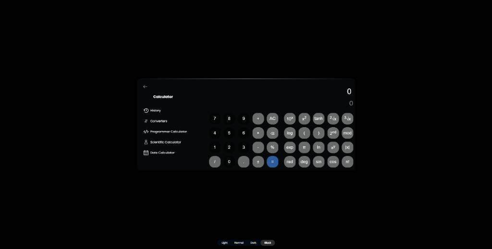
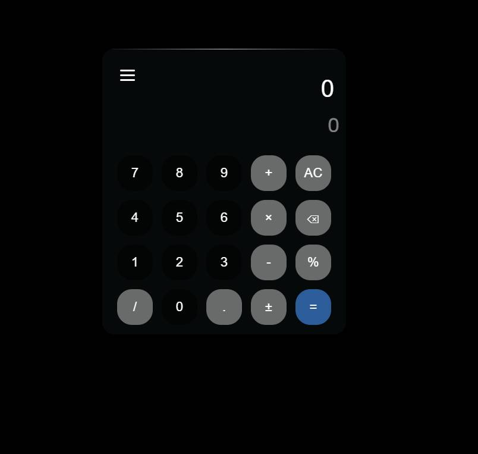

# 🧮 Advanced Universal Calculator

---

### 🛠️ Technologie i Stack:
* **Język core:** 🟡 JavaScript (Vanilla ES6+)
* **Warstwa wizualna:** 🔵 CSS3 (Responsive Design)
* **Struktura dokumentu:** 🟠 HTML5 (Semantic elements)

---

## 📸 Podgląd aplikacji / Preview

<p align="center">
  <table>
    <tr>
      <td align="center" valign="top" width="65%">
        <kbd><b>Wersja Desktop (Scientific / Programmer)</b></kbd><br><br>
        
      </td>
      <td align="center" valign="top" width="35%">
        <kbd><b>Wersja Mobile</b></kbd><br><br>
        
      </td>
    </tr>
  </table>
</p>

---

An advanced, feature-rich web calculator application built entirely from scratch. This project demonstrates extreme proficiency in vanilla structural programming, algorithmics, and heavy state management without the use of external UI or mathematical frameworks.

## 🔗 Live Demo
Explore the fully operational application here: **[vscode-magic.github.io/Calculator](https://vscode-magic.github.io/Calculator/)**

---

## 🧠 Technical Highlights & Architecture
* **Pure Vanilla JS Mastery:** Contains over **4,000 lines of highly structural, custom JavaScript** managing dense state and deeply nested visual layouts.
* **Complex Data Modeling:** Features dedicated parsing logic for multiple operating modes, eliminating any reliance on dangerous evaluation methods like `eval()`.
* **Zero Dependencies:** Built exclusively with core web standards (**HTML5, CSS3, JavaScript**), ensuring extreme performance and fast load times.

---

## 🚀 Key Modules & Functionality

### 💻 Programmer Calculator
* **Base Conversion:** Seamless, real-time conversion between Decimal (Dec), Binary (Bin), Octal (Oct), and Hexadecimal (Hex) numbering systems.
* **Bitwise Operations:** Low-level logic emulation including standard gates: `AND`, `OR`, `XOR`, and `NOT`.
* **Bit Manipulation:** Fully custom implementation of Bit Shifts (Left Shift `Lsh`, Right Shift `Rsh`) and Rotate operations.
* **Data Type Modeling:** Adjustable word size limits (8-bit, 16-bit, 32-bit, 64-bit) to strictly emulate physical hardware memory boundaries.

### 🔄 Multi-Unit Converters
* **Length & Distance:** Instant conversion between Meters, Feet, Miles, Kilometers, Inches, and Yards.
* **Volume & Capacity:** Precise calculation across Liters, Gallons, Quarts, Milliliters, and Cubic Meters.
* **Weight & Mass:** Support for Kilograms, Pounds, Ounces, and Tons.
* **Thermodynamics & Speed:** Conversions for Celsius, Fahrenheit, Kelvin, km/h, mph, and m/s.
* **Real-time Finance:** Integrated conversion module for live global currency exchange rates.

### 📅 Advanced Date Analytics
* **Date Difference:** High-precision timeline calculator displaying the exact number of days, weeks, and months between any two selected dates.
* **Date Arithmetic:** Dynamic offset engine allowing users to add or subtract arbitrary amounts of time from any given date.
* **Chronological Mapping:** Instant day-of-week determination for any historical or future anchor date.

---

## 🛠️ Tech Stack & Setup
* **Frontend:** Semantic HTML5, Modular CSS3 (with responsive layouts)
* **Core Engine:** Vanilla JavaScript (ES6+)

To run this project locally, simply clone the repository and open `index.html` in any modern web browser:
```bash
git clone https://github.com
cd Calculator
```
